# AskToNote

**提问式学习智能体：从一个问题出发，边问、边标注、边把解释原地扩写进同一份 Markdown 笔记。**

> 核心主张：**每一个陌生点，都是一个可以延伸的问题；每一次标注，都是笔记的扩写。**

不用先搭知识框架、也不用把回答复制到别处整理——你只要提问，然后在 AI 的回答里划出不认识的词，剩下的「生成候选问题 → 选深度 → 原地插入解释 → 记下已理解」全部由系统接管。一轮下来，你既搞懂了一串概念，也顺手留下一份结构化、可导出、能长期维护的笔记。

<p align="center">
  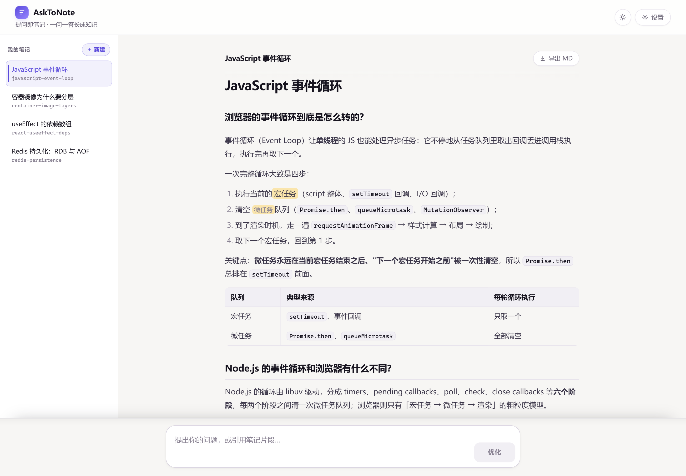
</p>

设计文档（SDD 三层）：[Spec.md](docs/Spec.md) · [Plan.md](docs/Plan.md) · [Tasks.md](docs/Tasks.md)

---

## 目录

- [它解决什么问题](#它解决什么问题)
- [界面速览](#界面速览)
- [核心特性](#核心特性)
- [使用流程（配图走一遍）](#使用流程配图走一遍)
- [工作原理](#工作原理)
- [快速开始](#快速开始)
- [配置项](#配置项)
- [API 一览](#api-一览)
- [数据模型](#数据模型)
- [记忆与掌握度规则](#记忆与掌握度规则)
- [目录结构](#目录结构)
- [测试](#测试)
- [常见问题](#常见问题)
- [已知边界与 v2 规划](#已知边界与-v2-规划)

---

## 它解决什么问题

拿 AI 学新东西时，大多数人是这样过的：

| 常见做法 | 结果 |
|---|---|
| 对着聊天窗口连续追问，答案散落在几十条消息里 | 关掉窗口什么都没留下，下次还得重问 |
| 让 AI「整理成笔记」，再把笔记复制到 Obsidian / Typora | 整理时的解释不是「你不懂的那一处」，而是 AI 猜的重点 |
| 遇到陌生词先跳过，想着「回头再查」 | 回头不会查，链条断在这里 |

AskToNote 把这三件事并成一件：**回答本身就是笔记，标注本身就是追问，解释直接长在原文旁边**。你不必在「聊天」和「记笔记」之间来回搬运，也不必告诉 AI 你哪里不懂——划一下它就知道了。

## 界面速览

左侧是主题列表（一篇笔记 = 一个主题），中间是笔记区，底部是提问 / 问题确认区，右上角可切换明暗与打开设置。

| 亮色 | 深色 |
|---|---|
|  | 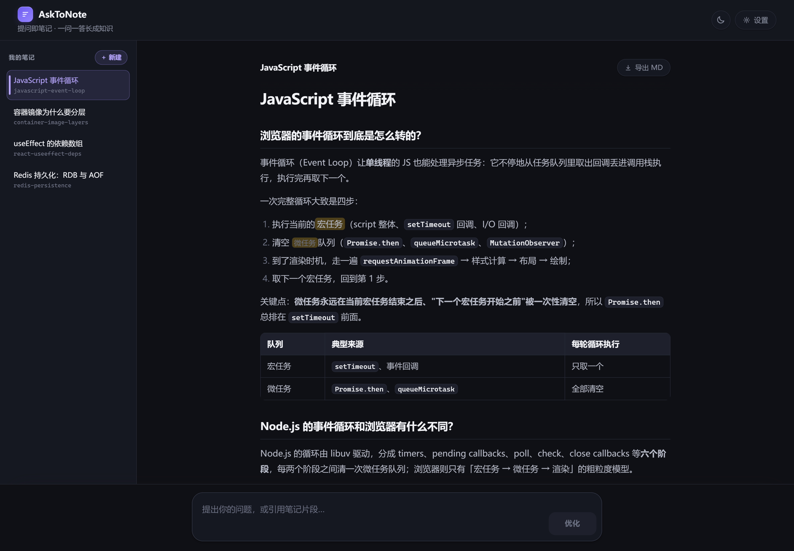 |

首次打开（还没有任何主题）时是引导态：

<p align="center">
  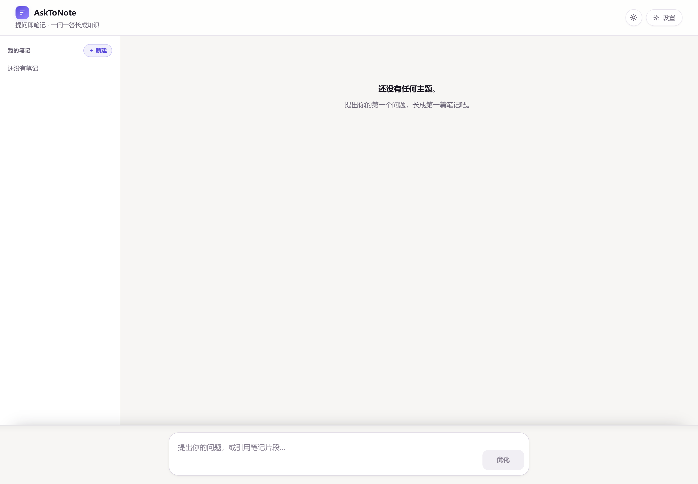
</p>

## 核心特性

### 1. 回答即笔记：没有「AI 回答区」

AI 的回答以 SSE 流式（打字机效果）**直接追加进笔记区**，落盘为 `## {问题}` + 回答正文的 Q/A 区块，写入 `backend/data/notes/{slug}.md`。界面上不存在「聊天记录」这层中间物——你看到的永远是最终笔记的样子。

### 2. 划词标注：按字数自动分流

在笔记区选中文字后，浮出「标注」气泡。判据只按**字符数**（去首尾空白后）：

- **≤ 60 字** → 视为一个陌生点，加入标注收集区，等用户点「生成候选问题」再**整批**调模型（不是每划一次就烧一次 token）；
- **> 60 字** → 视为「这一大段我没看懂」，自动降级为**追问**：作为引用片段移交底部提问区，走正常提问链路，回答追加为新的 Q/A 区块（不做锚点插入，也不写概念记忆）。

<p align="center">
  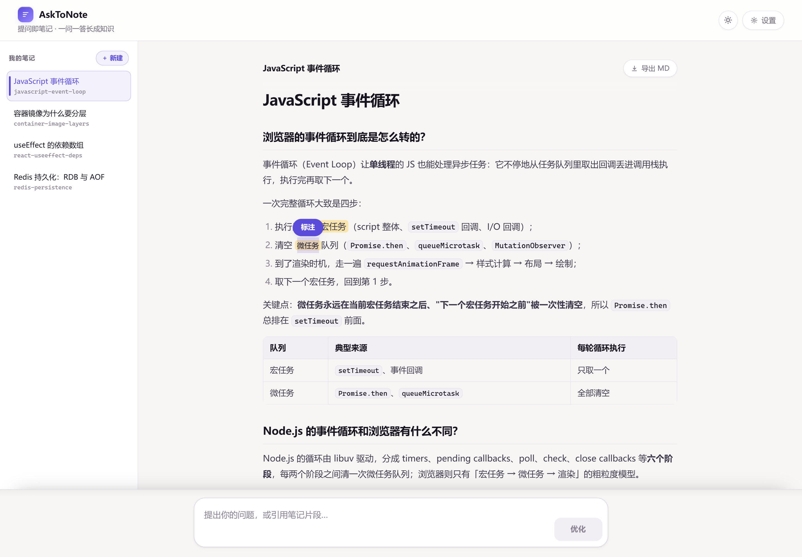
</p>

<p align="center">
  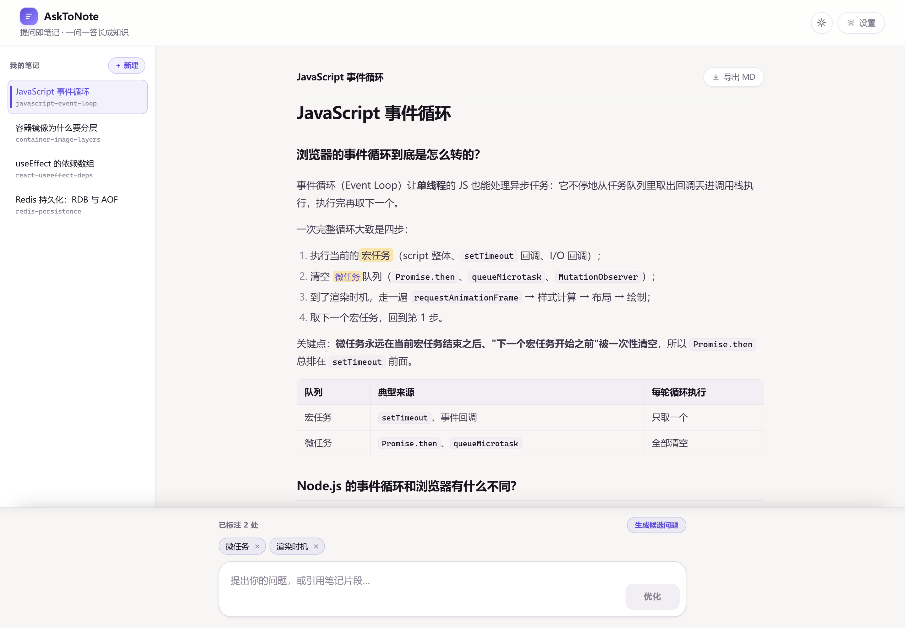
</p>

### 3. 原地扩写：解释长在原文旁边

每个标注都会先被翻译成一个**具体的候选问题**（而不是「解释一下 XX」这种泛问），确认后按所选深度写回笔记：

| 深度 | 写法 | 效果 |
|---|---|---|
| **简单了解** `brief` | `==原词==<a id="anno-xxx"></a>（一句话简释）` | 括号简释紧贴原词，不打断阅读 |
| **深入了解** `deep` | `[==原词==](#anno-xxx)` + 文末 `####` 新章节 + `[↩]` 回跳 | 原词与文末章节**双向可点击跳转**，导出后在任意 Markdown 阅读器里仍然可用 |

名词还有统一约定：**首次出现**用行内代码（`` `容器` ``），**本笔记已解释过**的用 `==名词==` 高亮（Typora / Obsidian 通用语法），**跨主题**引用写 `[[slug#概念]]`。

### 4. 一次一个：读懂了才继续

标注可能一次攒了好几个，但系统**不会**一口气把解释全塞进笔记——那样你也读不进去。扩写按队列串行执行：**扩写一条 → 你读 → 点「已理解」或「跳过」 → 下一条**。

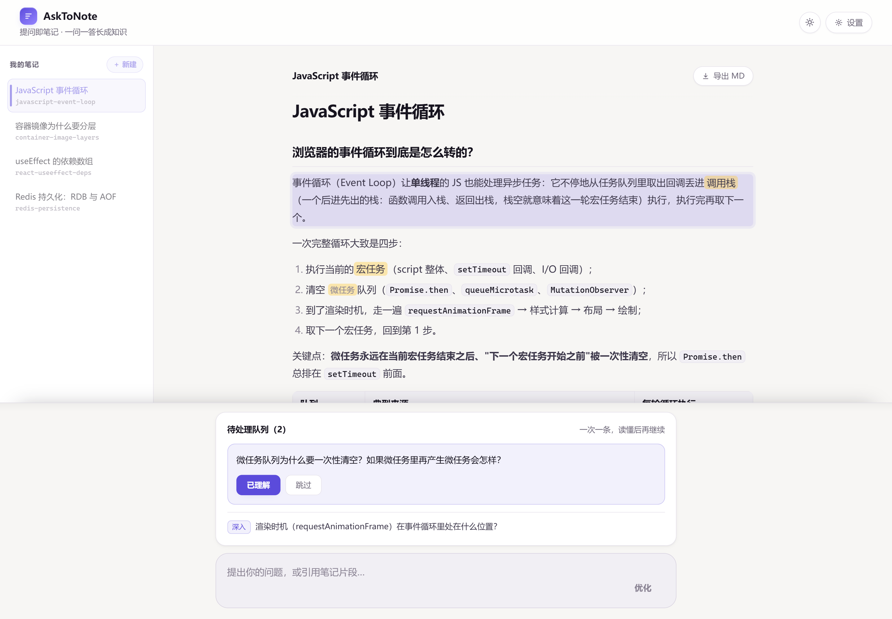

更妙的是下钻：在读刚写好的解释时，你还可以继续划词——新标注会**插到队列最前、优先处理**。于是学习自然变成一棵 DFS 树：问 A 的答案里有 B、C，标注 B 之后 B 的解释里又有 b1、b2……先懂叶子，再懂父，最后真正懂 A。

### 5. 用户记忆：掌握度只由你的显式动作驱动

- 概念被**标注**：进库（新概念记 10 分）、`pending=1`，**分数不变**；
- 点**「已理解」**：`pending` 清零、`score = min(100, score + 10)`，**幂等**，重复点不叠加；
- 概念分数**只读**——没有「我觉得我懂了」这种自评，也不会被 AI 悄悄改。

背景（「你熟悉什么、正在学什么」）由概念记忆推断，每次会话开始时刷新一次；在设置页手改后**自动锁定**，此后推断不再覆盖你的版本。

<p align="center">
  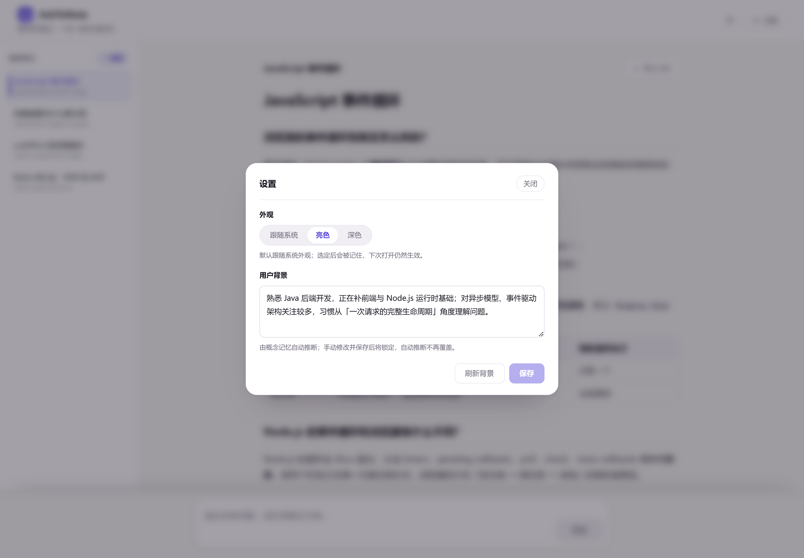
</p>

### 6. 主题管理与一键导出

一篇笔记一个主题文件（`data/notes/{slug}.md`）。侧边栏可随时切换，或点「＋ 新建」开新主题（slug 由 AI 命名、后端清洗去重，**用户不可改**）。笔记区右上角「导出 MD」是**纯前端**实现：直接用内存中的原文造 Blob 下载，文件名取主题标题。

### 7. 明暗主题

跟随系统 / 亮色 / 深色三态，选择写入 localStorage，首屏用内联脚本预置 `data-theme`，不闪白。

## 使用流程（配图走一遍）

```
提问 → 模式A 优化问题并确认 → 流式回答流入笔记
  → 划词标注陌生点 → 模式B 生成候选问题 → 确认
  → 【一次一个】选「简单/深入了解」→ 原地扩写
  → 读完点「已理解」（记忆 +10）或「跳过」→ 下一条
  → 可继续在新内容上标注（下钻插队优先）→ 循环
```

**① 提出一个问题**

在底部输入框写下问题，点「优化」。系统会结合你的背景与已掌握概念，把它改写成一个更具体、更容易得到好答案的问题，并把**目标主题**（并入当前 / 新建哪一篇）展示给你确认——**主题归属由你决定，不由 AI 猜**。

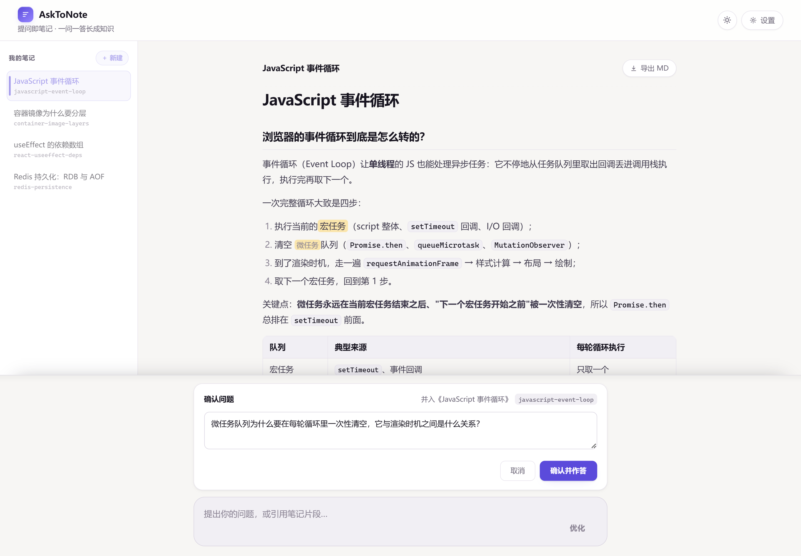

**② 确认并作答：回答直接长进笔记**

点击「确认并作答」后进入流式状态，新 Q/A 区块从笔记底部一段段长出来（流式期间禁止划词，避免选区错乱）：

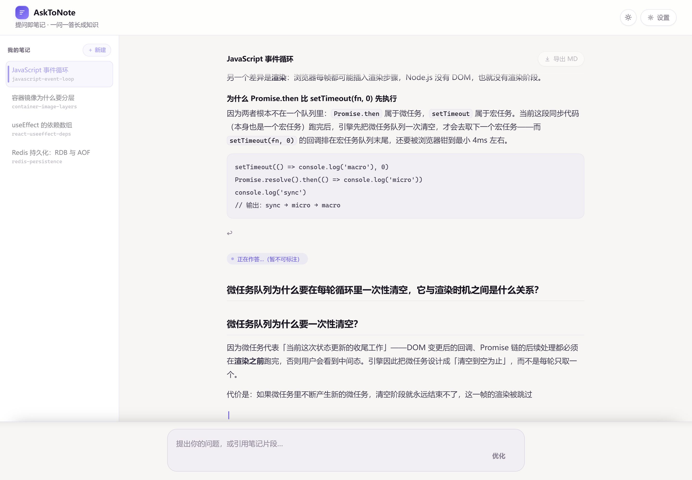

**③ 划词标注 → 生成候选问题 → 选深度**

选中陌生词 → 点气泡「标注」→ 攒够后点「生成候选问题」。每条候选问题可**编辑、删除**，并单独选「简单了解 / 深入了解」：

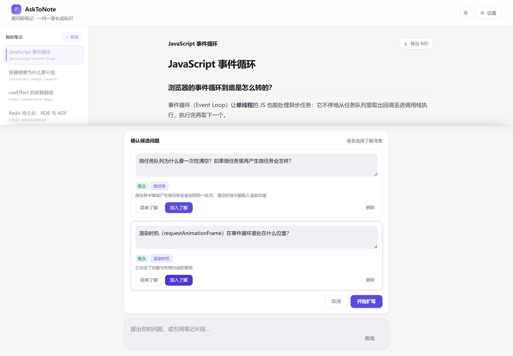

**④ 逐条扩写 → 已理解 / 跳过 → 下一条**

点「开始扩写」后进入串行队列：系统扩写当前条、滚动到解释处并短暂高亮，你读完点「已理解」推进下一条。单条失败会**停在该条**等你重试，不会跳过或乱序。


**⑤ 随时导出**

笔记区右上角「导出 MD」，得到的就是磁盘上那份 Markdown 原文（含 `==高亮==`、锚点与回跳链接）。

## 工作原理

### 六套 Prompt，两个智能体

「解答笔记智能体」负责**写**（作答 + 扩写），「问题优化智能体」负责**问**（把模糊的原始问题变成具体问题）：

| 环节 | 触发时机 | 输出 |
|---|---|---|
| **模式 A** 优化初始问题（优化版） | 点「优化」、并入当前主题 | JSON：`optimized_question` |
| **模式 A** 优化 + 主题命名（命名版） | 点「优化」、且显式新建主题 | JSON：`optimized_question` + `slug` + `title` |
| **模式 ①** 流式作答 | 确认问题后 | 流式纯 Markdown（无分隔符协议，直接透传 SSE `delta`） |
| **模式 B** 标注 → 候选问题 | 点「生成候选问题」 | JSON 数组：`snippet_index` / `text` / `concept` / `kind` / `reason` |
| **模式 ②** 标注扩写 | 队列逐条执行 | JSON：`insert_text`（括号简释）+ `new_section`（深入时才需要） |
| **背景推断** | 页面加载 / 设置页刷新 | JSON：`background` |

所有结构化输出都走 `chat_json`：解析或业务校验（如模式 B 的 `snippet_index` 必须恰好覆盖 `1..N`）不通过时，**把错误回喂重试一次**，仍失败由接口返回 `502`，前端提示。

### 一次交互的请求链路

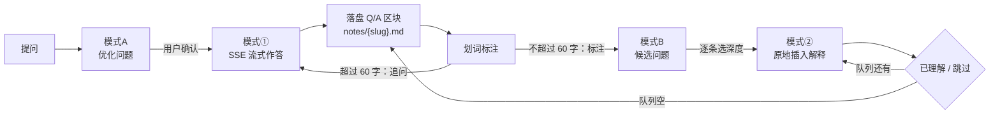

### 前端状态机（phase 是单一真相源）

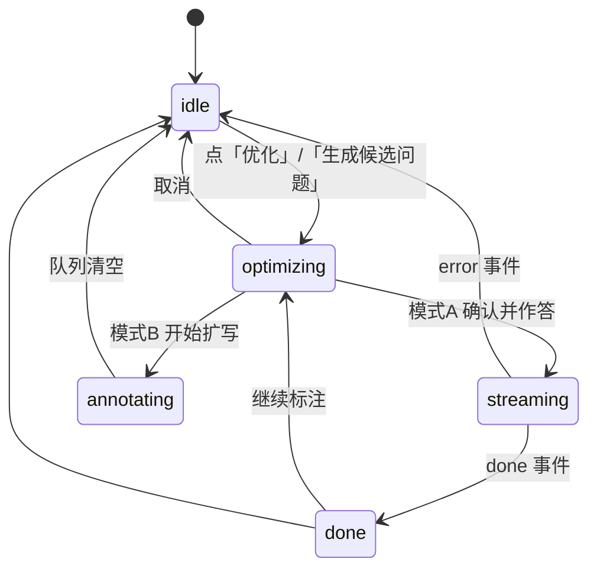

「是否正在流式」「能否划词」等判断都由 `phase` 派生（见 `store.ts` 的 `useIsStreaming` / `useCanAnnotate`），不再另设布尔字段。

### 后端写入顺序（一条标注）

```
读笔记 → 模式② → 定位插入点 → 写 annotations / questions →
写概念记忆 → 刷新 notes.updated_at → 返回最新全文 + anchor_id
```

插入点定位由后端工具函数完成，优先级：**源码 grep 命中（插到原词之后）→ 逐行脱标记命中（插到该行行末）→ 整段脱标记（段末）→ 仅命中标题行时改插到该标题下首个正文段**。笔记文件写入用模块级锁把「读 → 改 → 写」整段包成临界区，避免并发覆盖。

## 快速开始

### 环境要求

- Python **3.13**（`uv` 管理依赖）
- Node.js **20.19+ / 22.12+**（前端用 Vite 8 + React 19）
- 一个可用的 DeepSeek API Key

### 1. 启动后端

```bash
cd backend

# 配置环境变量
cp .env.example .env      # 编辑 .env，填入 DEEPSEEK_API_KEY

# 安装依赖（uv 会自动创建 .venv）
uv sync

# 启动服务（默认 http://127.0.0.1:8000）
uv run uvicorn main:app --reload
```

### 2. 启动前端

```bash
cd frontend
npm install
npm run dev               # 默认 http://localhost:5173
```

前端 dev 通过 Vite proxy 把 `/api` 转发到 `127.0.0.1:8000`（见 [vite.config.ts](frontend/vite.config.ts)），无需额外配置跨域；后端也开了 `CORS: *` 作为兜底。

打开页面后会自动打开**最近更新**的一篇笔记（「继续上次学习」）；没有笔记则显示引导态。

### 3. 数据落在哪

| 内容 | 位置 |
|---|---|
| 笔记 Markdown | `backend/data/notes/{slug}.md` |
| SQLite（概念 / 背景 / 主题索引 / 问题 / 标注） | `backend/data/asktonote.db` |

`backend/data/` 已被 `.gitignore` 忽略——它是你的学习数据，不进版本库。

## 配置项

后端只读 `backend/.env`（`app/config.py`）：

| 变量 | 默认值 | 说明 |
|---|---|---|
| `DEEPSEEK_API_KEY` | 空 | 必填，缺失时调用会失败 |
| `DEEPSEEK_BASE_URL` | `https://api.deepseek.com` | OpenAI 兼容端点 |
| `MODEL` | `deepseek-flash` | 模型名，改 `.env` 即可，不写死在代码里 |

## API 一览

| 方法 / 路径 | 说明 |
|---|---|
| `POST /api/optimize/initial` | 模式A：优化初始问题；`new_topic=true` 时另命名主题 `slug`/`title` |
| `POST /api/optimize/annotation` | 模式B：标注片段 → 候选问题列表 |
| `POST /api/answer` | 模式①：**SSE 流式**返回回答纯 Markdown，落盘为 Q/A 区块 |
| `POST /api/annotate` | 模式②：处理单个标注（含深度），原地扩写笔记 |
| `GET /api/note/{slug}` | 获取指定主题笔记内容 |
| `GET /api/notes` | 主题列表（按 `updated_at` 倒序） |
| `GET /api/memory` | 读用户知识记忆（背景 + 概念掌握度） |
| `POST /api/memory` | 手动纠正用户背景（概念分数只读、不可改；写入即锁定） |
| `POST /api/memory/confirm` | 对已标注概念确认「已理解」（清 pending、+10，幂等） |
| `POST /api/memory/refresh` | 会话级刷新背景推断（已锁定则直接返回已存背景） |

完整契约（含每个字段的语义与示例）见 [Plan.md §4](docs/Plan.md)。

**SSE 线格式**（`POST /api/answer`，不用 `event:` 名，一行一个 JSON）：

```
data: {"type":"delta","text":"事件循环"}
data: {"type":"delta","text":"让单线程的 JS"}
data: {"type":"done","note_markdown":"# JavaScript 事件循环\n\n## ..."}
data: {"type":"error","message":"..."}
```

**错误约定**：主题 / 概念不存在 → `404`；锚点定位失败 → `422`；LLM 输出解析失败（含重试后仍失败）→ `502`。

## 数据模型

SQLite 五张表（单用户，`user_profile` 固定一行）：

| 表 | 作用 | 关键字段 |
|---|---|---|
| `notes` | 主题索引 | `slug`（唯一）、`title`、`file_path`、`updated_at` |
| `concepts` | 概念掌握度 | `name`（唯一）、`score`、`pending` |
| `user_profile` | 用户背景 | `background`、`background_locked` |
| `questions` | 问题历史（只写不读） | `note_id`、`text`、`concept`、`source`（`initial`/`annotation`） |
| `annotations` | 标注历史（只写不读） | `note_id`、`snippet`、`concept`、`depth` |

笔记文件结构：

```markdown
# JavaScript 事件循环

## 浏览器的事件循环到底是怎么转的？

正文……当前的==宏任务==<a id="anno-7c1d0e5a"></a>（一次循环只取一个宏任务）……

#### 为什么 Promise.then 比 setTimeout(fn, 0) 先执行 <a id="anno-3f2a91b4"></a>

深入解释……

[↩](#anno-3f2a91b4-src)
```

- `## {问题}` 是一个 **Q/A 区块**，新提问只会**追加**区块，不改动旧内容；
- 标注扩写在该区块**内部原地插入**；`deep` 的新章节追加到文件最末尾；
- `<a id="anno-xxx">` 是解释侧锚点（前端扩写后据此滚动并高亮），`-src` 是原词侧锚点（供 `[↩]` 回跳）。

## 记忆与掌握度规则

| 等级 | 分数区间 |
|---|---|
| `unfamiliar` 陌生 | `< 20` |
| `blurry` 模糊 | `20–49` |
| `familiar` 熟悉 | `50–79` |
| `mastered` 掌握 | `≥ 80` |

- 等级由后端按 `score` 推导，**单一真相源**，前端不重算；
- 喂给 AI 的记忆按 `50` 分切成【已掌握】与【尚不熟悉】两档——避免把「你刚标注、其实还没懂」的词当成已掌握；
- 背景推断：`score ≥ 50` 的概念 → 「熟悉 X」，`score < 50`（多为刚标注） → 「正在学 X」；
- `pending` 是内部字段（标记「已标注、等待确认」），不返回前端。

## 目录结构

```
AskToNote/
├── docs/                 # Spec.md / Plan.md / Tasks.md（SDD 三层）
│   └── images/           # README 截图
├── backend/
│   ├── main.py           # FastAPI 入口（挂载路由 + CORS）
│   ├── app/
│   │   ├── config.py     # .env 读取 + 数据目录
│   │   ├── llm.py        # LLM 抽象层（DeepSeek / OpenAI 兼容 + usage 观测）
│   │   ├── prompts.py    # 六套 Prompt 模板与渲染
│   │   ├── parse.py      # JSON 解析 + 校验 + 回喂重试
│   │   ├── notes.py      # 笔记读写、段落定位插入、高亮升级
│   │   ├── memory.py     # SQLite 读写（概念 / 背景 / 主题 / 问题 / 标注）
│   │   ├── api.py        # 路由层（10 个接口）
│   │   └── agents/       # answer_note / question_optimizer / background
│   ├── tests/            # pytest（173 个用例）
│   └── data/             # asktonote.db + notes/*.md（git 忽略）
└── frontend/
    └── src/
        ├── store.ts      # zustand 状态机（phase 派生一切）
        ├── api.ts        # fetch 封装 + SSE 按行缓冲解析
        ├── theme.ts      # 明暗三态
        ├── remark-*.ts   # [[wikilink]] 与 ==高亮== 的 remark 插件
        └── components/   # NoteView / TopicList / AskBar / QuestionConfirm …
```

## 测试

```bash
cd backend
uv run pytest            # 173 passed
```

覆盖点包括：Prompt 渲染、JSON 兜底重试、段落定位与高亮升级、笔记落盘、记忆规则（幂等 / 分数边界）、SSE 事件序列、各接口的成功与错误分支。所有 LLM 调用在测试里通过依赖注入替换为假实现，**不会产生真实计费**。

## 常见问题

**Q：启动后 AI 一直不出结果 / 报 502？**
先确认 `backend/.env` 里的 `DEEPSEEK_API_KEY` 有效；`502` 多为模型返回的 JSON 不符合约定（比如候选问题数量对不上），看后端日志里的回喂重试记录。

**Q：`MODEL=deepseek-flash` 提示模型不存在？**
以 DeepSeek 官方文档的模型 ID 为准，改 `.env` 即可，代码里没有硬编码。

**Q：第一次打开设置页，背景是空的？**
正常。背景只在会话开始时推断，而概念要靠标注累积——第一次运行时 `concepts` 还是空的，从第二次启动起就有内容了；长会话中可点「刷新背景」手动再跑一次。

**Q：划词划了一大段，为什么没进标注列表？**
超过 60 字会自动降级为**追问**（引用片段会出现在底部输入框上方），这是设计而非 bug。

**Q：端口冲突 / 前端请求 404？**
后端默认 `8000`、前端 `5173`，Vite 代理固定转发到 `127.0.0.1:8000`（用 IP 而非 `localhost`，避免解析到 IPv6 导致代理失败）。改了后端端口就要同步改 `vite.config.ts`。

**Q：想清空重来？**
删掉 `backend/data/`（`asktonote.db` 与 `notes/`）即可，注意这会连同笔记一起删除。

## 已知边界与 v2 规划

当前是**单用户 v1**，有意为之的取舍（完整清单见 [Plan.md §12](docs/Plan.md)）：

- 同一片段在笔记中出现多次时，定位取**首次出现**的段落；跨表格 / 嵌套列表 / 代码块的划词可能定位不准；
- 概念只做**精确同名匹配**，不做同义词合并；掌握度**不做遗忘衰减**；
- 反向内链、知识图谱、撤销标注、多用户（各表加 `user_id`）留待 v2；
- 上下文缓存命中率目前**只观测不优化**（LLM 层打印 `hit / miss / rate`）。

---

如果这个项目对你有帮助，欢迎 Star；也欢迎直接读 [Spec.md](docs/Spec.md) 看它原本想解决什么、[Plan.md](docs/Plan.md) 看每个边界是怎么被定下来的。
